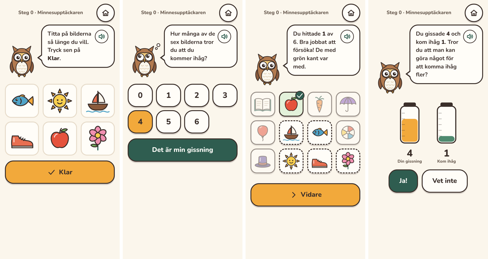
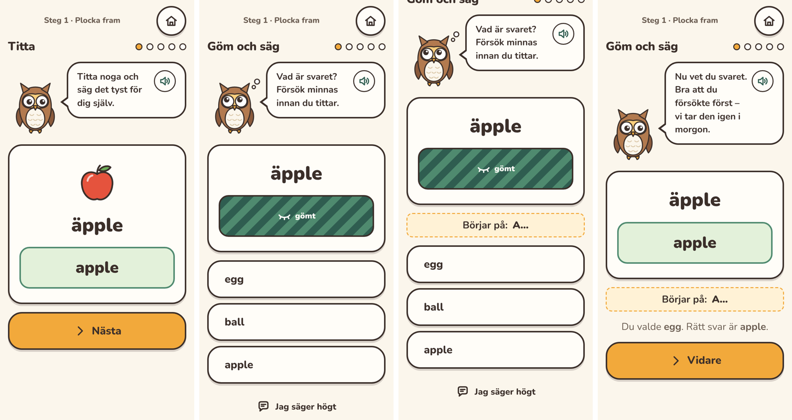
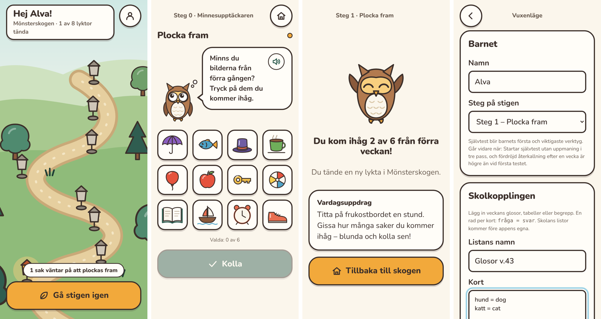

# Designguide: grafik

**All grafik i Minnesstigen är egenritad för projektet.** Inga ikonbibliotek,
illustrationsbanker, UI-kit eller stockbilder. Det ger ett eget, sammanhållet bildspråk,
undviker rättighetsproblem (se [06](../06-integritet-och-etik.md)) och gör att vi kan rita
exakt det pedagogiken kräver – t.ex. *levande, handlande figurer* (Blunt & VanArsdall 2021).

Grafiken skrivs som **SVG i React-komponenter** under [`src/graphics/`](../../src/graphics).
Det gör den skarp på alla skärmar, liten, temabar och lätt att animera. Se
[ADR 0002](../adr/0002-egen-grafik-som-svg.md).

## Bildspråk

- **Platt färg med mjuk mörkbrun konturlinje** (`INK #3b2f2a`, runda hörn och ändar).
  Linjetjocklek ≈ 3,5 i en 100×100-ruta (4 för större figurer i 200-ruta).
- **Ljus från övre vänstra hörnet**: en vit, halvgenomskinlig glanslinje (`<Shine>`) på
  rundade föremål.
- **Varmt och lugnt**, inte skrikigt. Inga neonfärger, inga blixtar eller "jackpot"-effekter.
- **Vänliga ansikten** får föremål när det hjälper minnet (sol, stjärna) – levande
  figurer minns bättre.
- **Tydliga silhuetter**: varje föremål ska gå att känna igen i 64 px storlek.

## Palett

Definieras två gånger och hålls i synk: CSS-tokens i
[`src/ui/theme.css`](../../src/ui/theme.css) och konstanter i
[`src/graphics/palette.ts`](../../src/graphics/palette.ts).

| Token | Hex | Används till |
|---|---|---|
| ink | `#3b2f2a` | Konturer, text |
| cream | `#fbf6ec` | Bakgrund |
| paper | `#fffdf8` | Kort, knappar |
| forest-900/700/500 | `#1f3d35` `#2f5d50` `#4f8a6f` | Skogen, "rätt"/klart, sekundärknappar |
| moss | `#a8c98f` | Kullar |
| amber / amber-light | `#f2a93b` `#f8cf7f` | Primärknappar, Ugglan, tända lyktor |
| coral | `#e86f51` | Accent |
| sky | `#9fd3e6` | Fokusmarkering |
| berry | `#8b5fbf` | Accent |

Fel markeras **aldrig med rött kryss**. "Rätt" visas grönt; missade svar med streckad grön
kant – vi visar vad som var rätt, inte att barnet misslyckades.

## Typografi

Nunito (variabel, öppen licens OFL, självhostad via `@fontsource-variable/nunito`).
Typsnittet är det enda visuella elementet vi inte ritat själva – det kan bytas mot ett
eget/licensierat typsnitt senare. Bastext 20 px; rubriker extra feta.

## Karaktärer och värld

| Del | Fil | Status |
|---|---|---|
| **Ugglan** – guide, lägen `happy`, `thinking`, `cheer`, `sleepy` | `Owl.tsx` | ✅ |
| **Föremål** – 16 st (äpple, fisk, nyckel, båt, hatt, sol, bok, sko, boll, kopp, blomma, paraply, stjärna, klocka, ballong, morot) | `pictures.tsx` | ✅ |
| **Ikoner** – 32-rutnät, `currentColor` | `icons.tsx` | ✅ |
| **Mönsterskogen** – stigen, lyktor som tänds per pass, träd | `ForestScene.tsx` | ✅ |
| Appikon | `public/icon.svg` | ✅ |
| Fokuseringsrummet – lugna animerade scener | – | M2 |
| Kroppslistan och absurda minnesbilder med levande figurer | – | M3 |
| Samlarfigurer och möbler till minnespalatset | – | M4 |
| Minnesbiblioteket, Vardagsbyn | – | Version 2 |

## Lägga till ett föremål

1. Lägg till en post i `drawings` i `src/graphics/pictures.tsx` med svenskt namn.
2. Rita i en 100×100-ruta, använd `outline`-attributen och paletten, lägg till `<Shine>`.
3. Kontrollera att det syns tydligt i 64 px och inte liknar ett befintligt föremål
   (viktigt i igenkänningstestet i Gissa och pröva).
4. Ta en skärmdump och lägg i PR:en.

## Tillgänglighet

- Alla bilder har `aria-label` (föremålets namn); dekor har `aria-hidden`.
- Tryckytor minst 60 px. Fokusmarkering med tydlig ring.
- `prefers-reduced-motion` stänger av animationer.

## Skärmdumpar (M1)

